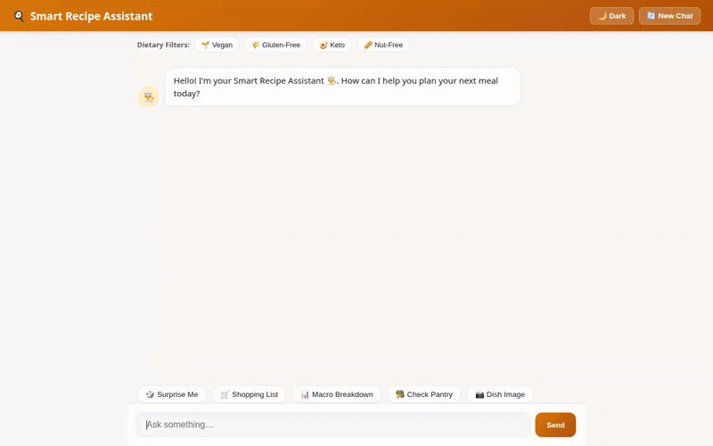

# 🍳 Smart Recipe Assistant

> An AI-powered culinary concierge built with **Google ADK (Agent Development Kit)**, **Gemini 2.5 Flash**, **Vertex AI Memory Bank**, **Cloud Firestore**, and **Google Cloud Storage**.



---

## 🌟 Overview

**Smart Recipe Assistant** is an agentic culinary web application designed to help home cooks plan meals, track pantry inventories, discover global recipes, generate dish photography and preparation videos, and adhere strictly to user dietary preferences and food allergies.

The agent renders rich UI components via **A2UI 0.8** (Agent-to-User Interface) and streams responses to a custom, modern FastAPI web interface.

---

## 🚀 Key Implemented Capabilities

Every feature listed below is fully implemented and wired in the codebase (`app/` and `frontend/`):

- **🧠 Vertex AI Memory Bank**: Persists user dietary restrictions, food allergies (e.g., peanuts, gluten, dairy), and taste preferences across separate conversation sessions via `PreloadMemoryTool` and `add_session_to_memory`.
- **🗄️ Cloud Firestore Database**: Manages local recipe storage and pantry inventory lookups (`search_recipes`, `get_recipe_details`, `add_new_recipe`).
- **🖼️ Multimodal Dish Image Generation**: Uses `gemini-3.1-flash-lite-image` to generate realistic food photography, uploads the output directly to a public Google Cloud Storage bucket in memory, and returns public HTTPS image URLs (`generate_recipe_dish_image`).
- **🎥 Dish Preparation Video Generation**: Uses Google's Omni model (`gemini-omni-flash-preview`) in the `global` region to synthesize short cooking videos, saving them as ADK artifacts and uploading to public Cloud Storage (`generate_recipe_video`).
- **🎨 Rich A2UI 0.8 Display Cards**: Emits structured JSON schemas for Cards, Columns, Text, and Images rendered natively by the frontend.
- **🗺️ Google Maps Geocoding & Places APIs**: Searches for nearby supermarkets, grocery stores, and specialty markets using Google Maps Geocoding and Places (New) APIs (`geocode_address`, `find_nearby_places`).
- **🌐 Global Culinary Data**: Integrates with TheMealDB REST API to search and retrieve international recipes (`fetch_global_recipes_from_mealdb`).
- **🐍 Python Code Execution Sandbox**: Runs data analysis and Python snippets safely using `AgentEngineSandboxCodeExecutor`.
- **🖥️ Custom Responsive Web Interface**: A FastAPI proxy web app featuring dietary filter chips, quick action buttons, animated chef loaders, image lightbox previews, session resets, and dark/light bistro themes.

---

## 📋 Status of Features

| Feature | Status | Implementation Details |
| :--- | :--- | :--- |
| **Dietary Memory Guardrails** | ✅ Implemented | Vertex AI Memory Bank (`PreloadMemoryTool`) |
| **Firestore Recipe Lookup** | ✅ Implemented | Cloud Firestore API (`app/tools.py`) |
| **Image Generation** | ✅ Implemented | `gemini-3.1-flash-lite-image` + GCS Bucket |
| **Video Generation** | ✅ Implemented | `gemini-omni-flash-preview` (global region) + GCS |
| **Maps & Grocery Locator** | ✅ Implemented | Google Maps Geocoding & Places (New) APIs |
| **Code Execution Sandbox** | ✅ Implemented | `AgentEngineSandboxCodeExecutor` |
| **A2UI Card Renderer** | ✅ Implemented | A2UI 0.8 Schema + Custom JavaScript Renderer |
| **Barcode Scanner / OCR** | ⏳ Planned | *Planned for future release; not yet implemented.* |

---

## 🛠️ Repository Structure

```
smart-recipe-agent/
├── app/
│   ├── agent.py               # Root agent definition, system prompt, tool registry
│   ├── tools.py               # Firestore, GCS, Image/Video Gen, Maps & MealDB tools
│   └── a2ui_utils.py          # A2UI 0.8 model output callback transformer
├── frontend/
│   ├── main.py                # FastAPI proxy server (A2A protocol)
│   ├── requirements.txt       # Frontend dependencies
│   ├── Dockerfile             # Container configuration for Cloud Run
│   └── static/
│       └── index.html         # Custom chat web UI with A2UI renderer
├── agents-cli-manifest.yaml   # Agent Engine deployment manifest
├── deployment_metadata.json   # Remote Reasoning Engine resource mapping
├── demo.gif                   # Looping demonstration recording
└── README.md                  # Project documentation
```

---

## 💻 Local Development & Setup Instructions

Follow these steps to run the agent backend and custom web frontend on your machine:

### 1. Prerequisites
- Python 3.11+
- Google Cloud SDK (`gcloud`)
- `uv` package manager (`pip install uv`)

### 2. Environment Configuration
Create a `.env` file in the root directory:

```bash
GOOGLE_GENAI_USE_VERTEXAI=true
GOOGLE_CLOUD_PROJECT="your-gcp-project-id"
GOOGLE_CLOUD_LOCATION="us-central1"
GOOGLE_MAPS_API_KEY="YOUR_MAPS_KEY"
```

### 3. Running the Backend Agent (ADK Web Playground)

To test the agent locally using the ADK Web interface:

```bash
# Install backend dependencies
uv sync

# Launch local ADK Web playground with memory service
uv run adk web . --port 8000 --reload_agents
```

### 4. Running the Web Frontend

To run the custom FastAPI chat frontend locally:

```bash
cd frontend

# Install frontend requirements
pip install -r requirements.txt

# Set deployment resource variables
export AGENT_ENGINE_RESOURCE_NAME="projects/YOUR_PROJECT_NUMBER/locations/us-central1/reasoningEngines/YOUR_ENGINE_ID"
export AGENT_DIRECTORY="app"
export PORT="8080"

# Start the proxy server
python main.py
```

After starting the server, open your web browser to port `8080`.

---

## ☁️ Deployment

### Deploying the Agent to Agent Platform (Agent Runtime)

```bash
agents-cli deploy \
  --project YOUR_PROJECT_ID \
  --region us-central1 \
  --update-env-vars GOOGLE_MAPS_API_KEY="YOUR_KEY"
```

### Deploying the Web Frontend to Cloud Run

```bash
cd frontend

gcloud run deploy smart-recipe-frontend \
  --source . \
  --region us-central1 \
  --allow-unauthenticated \
  --set-env-vars="AGENT_ENGINE_RESOURCE_NAME=$AGENT_ENGINE_RESOURCE_NAME,AGENT_DIRECTORY=$AGENT_DIRECTORY"
```

---

## 📄 License

Licensed under the Apache License, Version 2.0.
